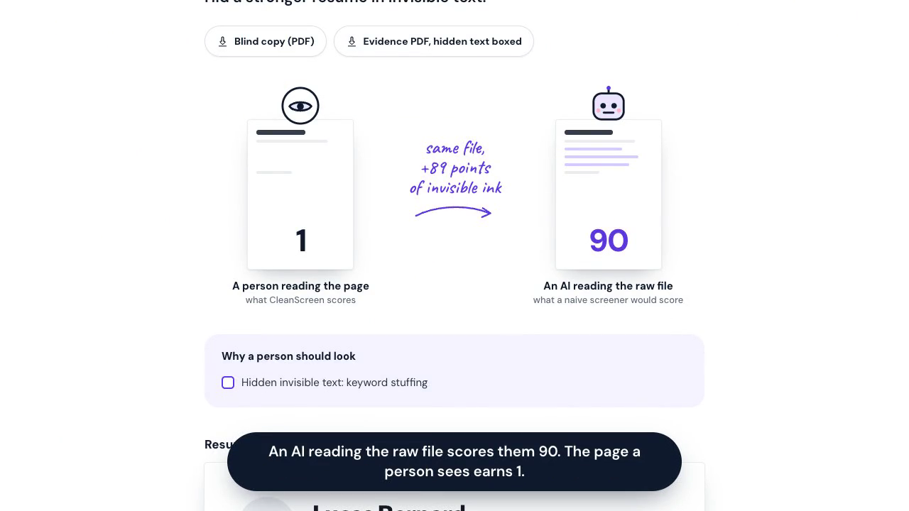
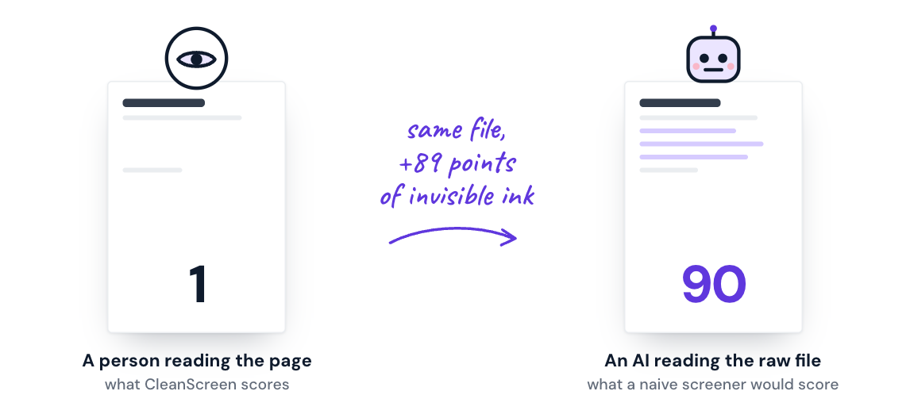

# CleanScreen

[](https://github.com/Loharanontsoanael/cleanscreen/actions/workflows/ci.yml)

**Resume screening you can't trick.** CleanScreen scores the resume a person actually sees, with identity removed, checks what applicants claim against their references, and explains every decision. Built on all nine [Clocked](https://clocked.rezolve.ai) endpoints for the Clocked Build Challenge.

**Live demo: [cleanscreen.vercel.app](https://cleanscreen.vercel.app)** · no sign-up · every applicant in the demo is fictional


[](https://cleanscreen.vercel.app/cleanscreen-demo.mp4)

**▶ [Watch the 90-second demo](https://cleanscreen.vercel.app/cleanscreen-demo.mp4)** (recorded on the live site, including a live screening of four sample applicants)

## Three minutes for judges

1. **The demo round** ([cleanscreen.vercel.app](https://cleanscreen.vercel.app), scroll to the shortlist): ten fictional applicants, each stamped with a next step.
2. **Candidate B**: a person's reading scores 1, an AI reading the raw file scores 90. Move the UV lamp over the resume to find the hidden role, then download the evidence PDF (hidden text boxed) and the blind copy (identity redacted by `/pii`).
3. **Candidates E and I**: claims contradicted by a reference letter and a certification lookup (`/grounding`), and take-home code that posts AWS credentials to a server (`/script`). "How this was decided" at the bottom of each page lists every Clocked call.
4. **Live**: on [/run](https://cleanscreen.vercel.app/run), press "Try sample applicants", then "Screen 4 applicants". All nine endpoints run live in under a minute.
5. **The record**: export the round's audit report from the shortlist, and read the [system card](docs/system-card.md) for intended use, evaluation and limitations.

## The problem

Applicants have learned that an AI reads their resume first, and some write for the AI instead of the recruiter.

- **1% of 200,000 real resumes** submitted through a hiring platform contained hidden instructions aimed at AI screeners ([Duke University, 2026](https://today.duke.edu/2026/08/tricking-ai-job-hunt)). More than 90% of that hidden text is not an obvious "hire me" but invisible keywords and claims.
- **67% of HR leaders** say AI-generated applications are slowing hiring down ([Robert Half, 2026](https://www.staffingindustry.com/news/global-daily-news/67-of-hr-leaders-say-ai-generated-applications-slow-hiring)).
- **64% of employers** have hired someone who misrepresented their skills ([Criteria and Lighthouse Research, 2026](https://www.criteriacorp.com/research/2026-lighthouse-research-report)).

Applicant tracking systems were built to parse and rank resumes, not to check them. A screener that reads the raw file can be steered by text no person ever sees.

## What CleanScreen does

1. **Reads the file twice.** Once as a person sees the rendered page, once as a text extractor reads it. Anything only the machine can read (white text, microscopic text, text off the page or under a shape, metadata, invisible Unicode characters) is flagged and classified.
2. **Scores it blind.** Name, contact details, age, location and family status are removed. Each job requirement is judged on the visible, anonymised resume, with the passage that proves it.
3. **Checks the story.** Claims are verified against references and credential records, the resume against the cover letter and against other applicants, and take-home code is inspected before anything runs it.
4. **Hands over a decision a person can act on.** One plain sentence, the evidence, a checklist of why a person should look, the requirements and interview questions aimed at what could not be verified. Two PDFs go with it: a blind copy (identity redacted by Clocked, hidden text removed) and an evidence copy with every finding boxed. The policy is enforced in code: a model recommendation never overrides an integrity finding, an unsure verdict goes to a person instead of being acted on, and a person makes the final call.

In the demo round, one applicant printed a whole senior role in white ink inside their experience section. **An AI reading the raw file scores them 90/100. CleanScreen, scoring the visible page, gives 1/100**, and the UV lamp on the applicant page shows exactly where the hidden role sits.




| The UV lamp reveals hidden ink | Claims checked against references |
| --- | --- |
|  |  |

## How it uses Clocked

Every endpoint changes what the app does or shows. All calls run server-side with the account key.

| Endpoint | What CleanScreen asks it | What changes in the app |
| --- | --- | --- |
| **/injection** | Does the machine-readable text try to instruct, steer or override the AI screener? | Flags the application and highlights the exact passage (spans) on the resume; with `return_pdf: "box"`, boxes it in the downloadable evidence PDF. |
| **/decide** | (1) What is each hidden passage trying to do: instruction to the AI, keyword stuffing or harmless? (2) Is each job requirement met, not met or not shown? (3) The same question on the raw file, as a naive screener would see it. | Classifies hidden text; drives the requirements checklist and the fit score; the counterfactual produces the "an AI reading the file: 90" comparison. |
| **/pii** | Which spans are names, emails, phones, addresses, locations, dates of birth or family status? | Produces the anonymised copy that every scoring step reads (blind screening); with `return_pdf: "redact"`, the blind PDF a reviewer can download. |
| **/extract** | Roles, skills, education and certifications, verbatim with positions. | Builds the structured profile behind the scorecard. |
| **/rerank** | Which resume and reference passages answer each requirement? | Shows the proof behind each requirement verdict. |
| **/grounding** | Is each resume claim supported, contradicted or not stated by the references and credential records? | Contradicted claims become integrity findings with the record that contradicts them. |
| **/compare** | (1) Do resume and cover letter disagree? (2) Are any applicants' resumes copied or templated from each other? | Flags conflicting dates and copied resumes across the applicant pool. |
| **/script** | Is the take-home submission safe to run, and which lines are the problem? | Blocks the grader and shows the offending lines (e.g. reading `~/.aws/credentials` and posting it out). |
| **/fill** | A scorecard: seniority, next-step recommendation, summary and interview questions targeted at unverified claims. | Seniority label, interview questions; the recommendation is kept for reference, while the policy in code makes the decision. |

Every call is recorded with its purpose, model time and credits, and shown on the applicant page under "How this was decided". The demo round of ten applicants used **141 calls and 751 credits**, the two PDF copies of every resume included (about **75 credits, or roughly 1.5 US cents, per applicant**), with about 17 seconds of total model time.

## Reliability and Clocked best practices

- **Idempotency and retries as the docs describe.** The SDK retries 429, 5xx and network failures under one idempotency key, so work is billed once. When Clocked answers that an attempt has ended (`retryAsNew`), CleanScreen starts a fresh attempt, at most twice, by choice rather than by default.
- **A bounded queue.** All calls go through one semaphore sized to the account's concurrency allowance (`CLOCKED_CONCURRENCY`), instead of an unbounded fan-out; throttling never raises parallelism.
- **Inside every admission limit.** `src/lib/limits.ts` holds the documented limits, and every request is shaped to fit: text longer than 60,000 characters is split for `/injection` and `/pii` and the returned spans are mapped back to the full text; `/decide` gets at most 64 documents, `/rerank` 256 passages, `/grounding` 20 records and 30 claims, `/compare` 20 documents within its character budget. Offsets are handled in Unicode code points, the unit Clocked uses.
- **Essential and secondary steps.** If an essential step fails (the manipulation check, anonymisation, the blind requirement judgment), only that application stops and the round reports why. If a secondary step fails (proof passages, reference checks, the cover letter, take-home code, the scorecard), the application is screened without it, the page says what was not checked, and it cannot go straight to interview.
- **Account problems stop cleanly.** A rejected key, an exhausted credit balance or an inactive plan ends the screening with one clear message instead of failing applicant by applicant.
- **Nothing wasted.** When a visitor leaves mid-screening, pending Clocked calls are cancelled through the SDK's `AbortSignal`.
- **Files it cannot read.** Corrupt, password-protected, image-only (scanned) and over-long PDFs are rejected with a reason before any credit is spent.
- **A daily credit ceiling.** Live screening reserves credits before a round starts and settles to what it spent; once the day's budget (`DAILY_CREDIT_BUDGET`) is used, `/run` says so and the saved demo round keeps working.
- **Tests without credits.** `npm test` runs 57 tests against generated PDFs and a fake Clocked client: hidden-text and Unicode detection for every method, honest designs that must not be flagged, unreadable files, every branch of the decision policy, the credit budget, the blind and evidence PDFs, the exports, clipped documents, chunking, failed and cancelled calls. GitHub Actions runs lint, type checks, tests and a production build on every push.

## Uncertain results, missing information and failed requests

Clocked returns probabilities, not just labels. CleanScreen acts on a verdict only when it is sure enough, and every threshold lives in one place (`THRESHOLDS` in `src/lib/policy.ts`). Whatever falls short goes to a person with the reason written out, never to an automatic yes or no.

| Situation | What CleanScreen does | Reason shown to the reviewer |
| --- | --- | --- |
| A must-have is judged met or not met with less than 60% confidence | Closer look, never advance or reject | "Uncertain: Python in production (55%)" |
| A must-have is not shown on the resume | Closer look | "Not shown on the resume: …" |
| A must-have is clearly not met (80% or more) | Not a match | |
| `/injection` says benign, but at 30% or more | Closer look | "Possible instruction to the AI screener (40% likely)" |
| Hidden text classed as harmless with less than 60% confidence | Closer look | "Hidden invisible text of unclear purpose" |
| A claim contradicted by the records at 50 to 80% | Closer look (at 80% or more it is an integrity finding) | "Claim possibly contradicted by records: …" |
| Take-home code judged suspicious rather than malicious | Closer look (malicious is flagged) | "Take-home code looks suspicious: …" |
| The same hidden keywords in several applicants' files | Closer look: usually a shared template, not intent | "Hidden invisible text also in Candidate C: likely from a shared template" |
| The same hidden instruction to the AI in several files | Flagged | "… the same instruction to the AI appears in Candidate C" |
| A secondary request fails (references, cover letter, code) | Screened without it, cannot advance | "Not checked: claims against the references" |
| An essential request fails (manipulation check, anonymisation, blind judgment) | That applicant is not screened; the others are | Listed under files that could not be screened |
| The account is out of credits, or the key is rejected | The round stops with one message | |
| The PDF is scanned, encrypted, corrupt or too long | Rejected before any credit is spent | The reason, per file |

Decisions are made once the whole round is read, because some findings (copied resumes, shared hidden text) only show up across applicants.

## How the hidden-text detection works

Detection is visual, not a list of tricks. Each PDF page is rendered with MuPDF and every run of text is located on the bitmap: a run that leaves no ink where it should be is hidden, whatever produced it (white on white, colour matched to a background, invisible render mode, covered by a shape). Runs smaller than 4 pt or mostly outside the page are flagged too, and the Subject and Keywords metadata fields are read as hidden text. Clocked then judges what the hidden text is for.

Some tricks leave nothing to see because they live in the characters, not the ink. A font's ToUnicode table can say that a glyph drawing nothing means a whole sentence, or that the "o" on the page is a Cyrillic "о". CleanScreen reads the extracted characters for four of these: Unicode tag characters (invisible copies of ASCII, decoded and judged like any hidden text), zero-width characters, direction overrides that reorder what is displayed, and Latin words spelled with look-alike Cyrillic or Greek letters. Russian or Arabic words, direction marks in right-to-left text, "μs", flag emoji and a stray zero-width space from copy and paste are left alone. `/injection` then reads the words with the invisible characters taken out, so splitting a phrase with zero-width spaces does not hide it.

Building these tests surfaced a bug worth knowing: mupdf.js passes each extracted character through `String.fromCharCode`, which drops the high bits of anything beyond U+FFFF. An invisible tag character U+E0052 arrived as a visible "R", so a tag-encoded instruction would have been read as text on the page. CleanScreen now matches each character back to the page's full text export.

On a real two-page resume this produced no false alarm: the visible and the machine-readable text were identical.

## Benchmark

`scripts/benchmark.ts` generates 49 resumes and runs each through the same manipulation check the app uses (PDF forensics, then `/injection` and `/decide`).

- **37 attacks:** eleven ways of hiding text (white, near-white, 1 pt, 3 pt, off the page, invisible render mode, covered by a shape, PDF Subject, PDF Keywords, Unicode tag characters, a message in zero-width characters), each carrying three payloads (an instruction to the AI, keyword stuffing, a fake senior role), skills spelled with look-alike letters, and three instructions printed in plain sight.
- **12 honest resumes built to look suspicious:** a dark sidebar with white text, light grey dates, a 7 pt footer, a coloured header band, ordinary "Curriculum vitae" metadata, two pages, Russian and Arabic text with direction marks and "μs", stray zero-width spaces, and resumes that mention prompt engineering and prompt-injection red-teaming as skills.

| | Result |
| --- | --- |
| Attacks caught | **37 / 37** |
| False alarms on honest resumes | **0 / 12** |
| Cost of the whole run | 79 Clocked calls, about 175 credits |

The first run raised two false alarms: ordinary metadata such as "Subject: Curriculum vitae" was read as keyword stuffing. Metadata that only names the document or repeats words from the page is now ignored; real metadata attacks are still caught. A fixture that put a name and a greeting in two scripts after "Languages:" was flagged by `/injection`, fairly: the line made no sense. The honest multilingual resume now lists languages the way people do. Per-case results are in `data/benchmark/results.json`. Re-run with `node --env-file=.env.local --conditions=react-server --import tsx scripts/benchmark.ts`.

## Try it live

On [/run](https://cleanscreen.vercel.app/run), "Try sample applicants" loads four fictional applicants with their documents: one hides a senior role in white ink, one has references and a certification lookup that contradict the resume, one sends a cover letter with different dates, and one hands in take-home code that posts AWS credentials to a remote server. Screening them calls all nine endpoints live, in about a minute. Your own PDFs work the same way; clip documents to a resume with the tabs on its sheet.

## The demo round

Ten fictional applicants for a Senior Data Engineer role, each with a different situation:

| Applicant | Situation | Outcome |
| --- | --- | --- |
| A | Strong, honest, references confirm the claims | Interview |
| B | A senior role written in white ink | Hidden text (raw file 90, visible page 1) |
| C | Microscopic note telling the AI to rank them first | AI prompt |
| D | Instructions to the AI in the PDF metadata | AI prompt |
| E | Team lead and certification the references contradict | False claims |
| F, G | The same templated resume, sent by two people | Copied |
| H | Resume and cover letter disagree on dates | Conflict |
| I | Take-home code that exfiltrates credentials | Bad code |
| J | Honest career changer, short of the years required | Not a match |

The PDFs are generated by `scripts/generate-demo.mjs`; the saved analysis in `data/demo/report.json` is replayed by the home page, so visitors spend no credits.

## Use it from another system

The screening the web page runs is an HTTP API, so an applicant tracking system or a script can call it directly. Each request is a multipart form.

```sh
curl https://cleanscreen.vercel.app/api/screen \
  -H "Accept: application/json" \
  -F title="Senior Data Engineer" \
  -F 'requirements=[{"text":"5+ years of data engineering","mustHave":true},{"text":"Python and SQL in production","mustHave":true}]' \
  -F resumes=@alice.pdf -F resumes=@bob.pdf
```

| Endpoint | Sends | Returns |
| --- | --- | --- |
| `POST /api/screen` | `title`, `requirements` (JSON list of `{ text, mustHave }`, at most 8), `resumes` (1 to 10 PDFs, 3 MB each); optionally, for the resume at position `i` (from 0), `cover-i` (a cover letter), `reference-i` (up to 3 references or credential records) and `code-i` (take-home code), as PDF or text | With `Accept: application/json`, the whole round as JSON: per applicant `decision.outcome` (`advance`, `human_review`, `reject`, `flagged`) and `decision.reasons`, requirement verdicts with probabilities, hidden findings, and every Clocked call in `trail`. Without it, NDJSON progress events ending with `{ "type": "report" }`. |
| `POST /api/document` | `kind` (`blind` or `evidence`), `resume` (one PDF) | The blind copy or the evidence PDF. |

Errors come back as `{ "error": "..." }` with a 4xx or 5xx status: 429 past the hourly limit per visitor, 503 once the daily credit budget is spent or the Clocked account is unavailable. Nothing sent is stored.

From the shortlist, the round also exports as a CSV (one row per applicant, ready for a spreadsheet or an ATS import) and as an audit report in Markdown: the requirements, the decision rule, each decision with its reasons and verdicts, and every Clocked call behind it. Both leave names out.

## Run it locally

Requires Node.js 20+ and a Clocked API key (a free account plus the hackathon code gives 20,000 credits).

```sh
git clone https://github.com/Loharanontsoanael/cleanscreen.git
cd cleanscreen
npm install
cp .env.example .env.local     # then paste your key after CLOCKED_API_KEY=
npm run dev                    # http://localhost:3000
```

- `/` replays the saved demo round. `/run` screens your own PDFs live: clip a cover letter, references or take-home code to any resume with the tabs on its sheet, or press "Try sample applicants" to load four fictional applicants with their documents and run all nine endpoints live.
- Regenerate the fictional resumes: `node scripts/generate-demo.mjs`
- Re-run the analysis on them: `node --env-file=.env.local --conditions=react-server --import tsx scripts/run-demo.ts`
- In development, identical Clocked requests are cached in `.cache/` so iterating spends no credits.
- `npm test` runs the test suite (no key needed), `npm run lint` and `npm run typecheck` the static checks.

| Variable | Default | Purpose |
| --- | --- | --- |
| `CLOCKED_API_KEY` | (required) | Clocked account key, server-side only |
| `CLOCKED_CONCURRENCY` | `4` | Concurrent Clocked requests |
| `SCREEN_RUNS_PER_HOUR` | `5` | Live screenings per visitor per hour |
| `DAILY_CREDIT_BUDGET` | `3000` | Clocked credits live screening may spend per day (UTC) |
| `SCREEN_DISABLED` | unset | Set to `1` to pause live screening |

## Where things live

- `src/lib/forensics.ts`: the person-versus-machine reading of a PDF.
- `src/lib/analysis.ts`: the screening pipeline and the Clocked calls.
- `src/lib/clocked.ts`: the Clocked client wrapper (concurrency, retries, cancellation, error handling, audit trail, dev cache).
- `src/lib/policy.ts`: the decision rule and every threshold it uses.
- `src/lib/documents.ts` and `src/app/api/document/route.ts`: the blind copy and the evidence PDF.
- `src/lib/export.ts`: the CSV and the audit report.
- `src/lib/limits.ts` and `src/lib/budget.ts`: the documented API limits, and the daily credit ceiling.
- `tests/`: the test suite; `scripts/fixtures.ts` generates the resumes it and the benchmark use.
- `src/app/api/screen/route.ts`: live screening, streamed as NDJSON.
- `src/components/`: the shortlist, the applicant page and the UV lamp.

## Privacy and limits

The [system card](docs/system-card.md) covers intended use, the decision rule, evaluation, known limitations, fairness and human oversight in full.

- Uploaded resumes are read, screened and forgotten: nothing is stored by CleanScreen. Text is sent to Clocked for analysis.
- CleanScreen recommends; a person decides. Every flag says why and shows the passage behind it.
- Verification checks a claim against the records supplied, not against the outside world. A claim the records don't mention is "not covered", never "false".
- The resume layout on the applicant page is rebuilt from the PDF text; very free-form designs can put a subheading in the wrong place. Detection does not depend on it.

## License and credits

CleanScreen is released under the [GNU Affero General Public License v3.0](LICENSE), the license of the MuPDF library it builds on.


Built with [Next.js](https://nextjs.org), [Clocked](https://clocked.rezolve.ai) and its [JavaScript SDK](https://www.npmjs.com/package/clocked-sdk), [MuPDF.js](https://mupdf.com) (AGPL-3.0) for PDF rendering and text positions, [pdf-lib](https://pdf-lib.js.org) for the demo PDFs, [Hugeicons](https://hugeicons.com), and the DM Sans, JetBrains Mono, Caveat and Lato typefaces. Statistics are linked to their sources above. Built with the help of Claude Code.
