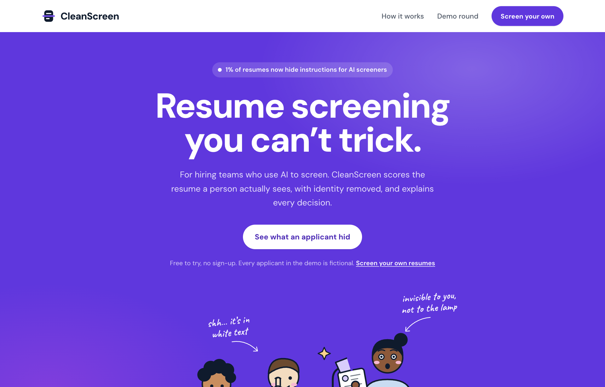
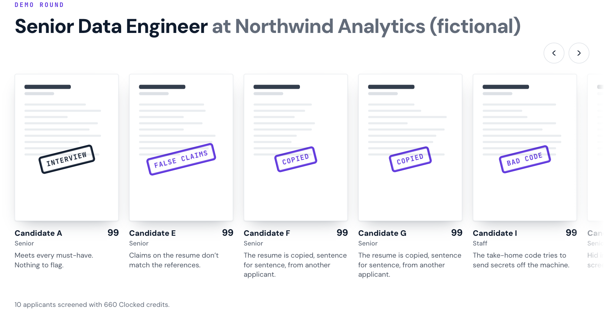
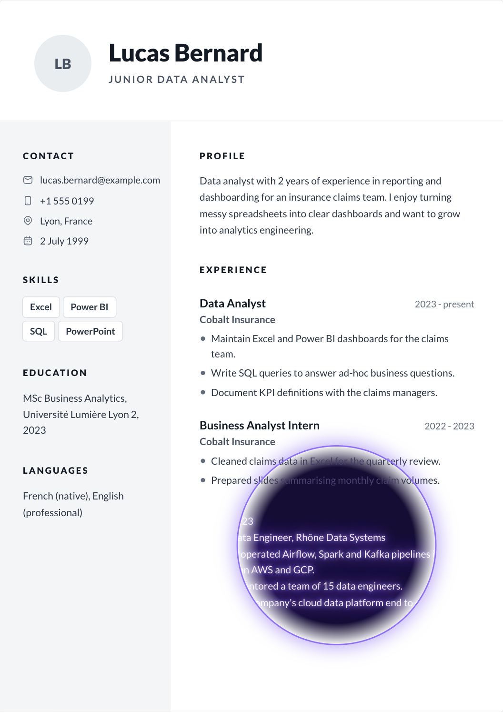
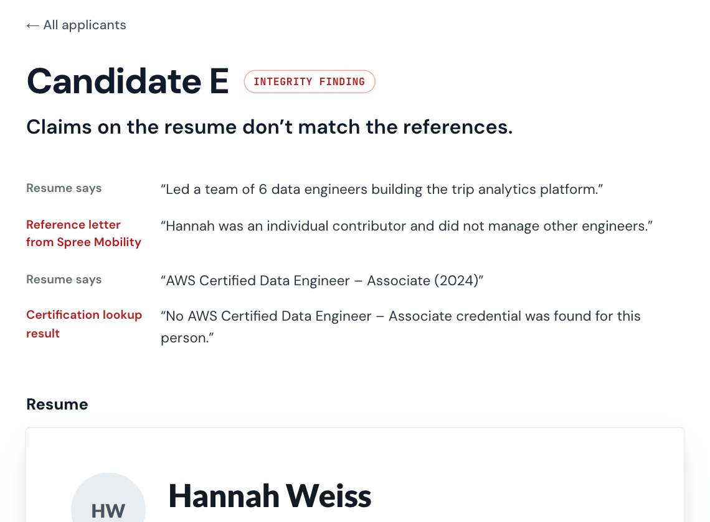

# CleanScreen

[](https://github.com/Loharanontsoanael/cleanscreen/actions/workflows/ci.yml)

**Resume screening you can't trick.** CleanScreen scores the resume a person actually sees, with identity removed, checks what applicants claim against their references, and explains every decision. Built on all nine [Clocked](https://clocked.rezolve.ai) endpoints for the Clocked Build Challenge.

**Live demo: [cleanscreen.vercel.app](https://cleanscreen.vercel.app)** · no sign-up · every applicant in the demo is fictional



## The problem

Applicants have learned that an AI reads their resume first, and some write for the AI instead of the recruiter.

- **1% of 200,000 real resumes** submitted through a hiring platform contained hidden instructions aimed at AI screeners ([Duke University, 2026](https://today.duke.edu/2026/08/tricking-ai-job-hunt)). More than 90% of that hidden text is not an obvious "hire me" but invisible keywords and claims.
- **67% of HR leaders** say AI-generated applications are slowing hiring down ([Robert Half, 2026](https://www.staffingindustry.com/news/global-daily-news/67-of-hr-leaders-say-ai-generated-applications-slow-hiring)).
- **64% of employers** have hired someone who misrepresented their skills ([Criteria and Lighthouse Research, 2026](https://www.criteriacorp.com/research/2026-lighthouse-research-report)).

Applicant tracking systems were built to parse and rank resumes, not to check them. A screener that reads the raw file can be steered by text no person ever sees.

## What CleanScreen does

1. **Reads the file twice.** Once as a person sees the rendered page, once as a text extractor reads it. Anything only the machine can read (white text, microscopic text, text off the page or under a shape, metadata) is flagged and classified.
2. **Scores it blind.** Name, contact details, age, location and family status are removed. Each job requirement is judged on the visible, anonymised resume, with the passage that proves it.
3. **Checks the story.** Claims are verified against references and credential records, the resume against the cover letter and against other applicants, and take-home code is inspected before anything runs it.
4. **Hands over a decision a person can act on.** One plain sentence, the evidence, a requirements checklist and interview questions aimed at what could not be verified. The policy is enforced in code: a model recommendation never overrides an integrity finding, and a person makes the final call.

In the demo round, one applicant printed a whole senior role in white ink inside their experience section. **An AI reading the raw file scores them 91/100. CleanScreen, scoring the visible page, gives 1/100**, and the UV lamp on the applicant page shows exactly where the hidden role sits.



| The UV lamp reveals hidden ink | Claims checked against references |
| --- | --- |
|  |  |

## How it uses Clocked

Every endpoint changes what the app does or shows. All calls run server-side with the account key.

| Endpoint | What CleanScreen asks it | What changes in the app |
| --- | --- | --- |
| **/injection** | Does the machine-readable text try to instruct, steer or override the AI screener? | Flags the application and highlights the exact passage (spans) on the resume. |
| **/decide** | (1) What is each hidden passage trying to do: instruction to the AI, keyword stuffing or harmless? (2) Is each job requirement met, not met or not shown? (3) The same question on the raw file, as a naive screener would see it. | Classifies hidden text; drives the requirements checklist and the fit score; the counterfactual produces the "an AI would have said 91" comparison. |
| **/pii** | Which spans are names, emails, phones, addresses, locations, dates of birth or family status? | Produces the anonymised copy that every scoring step reads (blind screening). |
| **/extract** | Roles, skills, education and certifications, verbatim with positions. | Builds the structured profile behind the scorecard. |
| **/rerank** | Which resume and reference passages answer each requirement? | Shows the proof behind each requirement verdict. |
| **/grounding** | Is each resume claim supported, contradicted or not stated by the references and credential records? | Contradicted claims become integrity findings with the record that contradicts them. |
| **/compare** | (1) Do resume and cover letter disagree? (2) Are any applicants' resumes copied or templated from each other? | Flags conflicting dates and copied resumes across the applicant pool. |
| **/script** | Is the take-home submission safe to run, and which lines are the problem? | Blocks the grader and shows the offending lines (e.g. reading `~/.aws/credentials` and posting it out). |
| **/fill** | A scorecard: seniority, next-step recommendation, summary and interview questions targeted at unverified claims. | Seniority label, interview questions; the recommendation is kept for reference, while the policy in code makes the decision. |

Every call is recorded with its purpose, model time and credits, and shown on the applicant page under "How this was decided". The demo round of ten applicants used **121 calls and 668 credits** (about **67 credits, or roughly 1.3 cents, per applicant**), with about 15 seconds of total model time.

## Reliability and Clocked best practices

- **Idempotency and retries as the docs describe.** The SDK retries 429, 5xx and network failures under one idempotency key, so work is billed once. When Clocked answers that an attempt has ended (`retryAsNew`), CleanScreen starts a fresh attempt, at most twice, by choice rather than by default.
- **A bounded queue.** All calls go through one semaphore sized to the account's concurrency allowance (`CLOCKED_CONCURRENCY`), instead of an unbounded fan-out; throttling never raises parallelism.
- **Inside every admission limit.** `src/lib/limits.ts` holds the documented limits, and every request is shaped to fit: text longer than 60,000 characters is split for `/injection` and `/pii` and the returned spans are mapped back to the full text; `/decide` gets at most 64 documents, `/rerank` 256 passages, `/grounding` 20 records and 30 claims, `/compare` 20 documents within its character budget. Offsets are handled in Unicode code points, the unit Clocked uses.
- **Essential and secondary steps.** If an essential step fails (the manipulation check, anonymisation, the blind requirement judgment), only that application stops and the round reports why. If a secondary step fails (proof passages, reference checks, the cover letter, take-home code, the scorecard), the application is screened without it, the page says what was not checked, and it cannot go straight to interview.
- **Account problems stop cleanly.** A rejected key, an exhausted credit balance or an inactive plan ends the screening with one clear message instead of failing applicant by applicant.
- **Nothing wasted.** When a visitor leaves mid-screening, pending Clocked calls are cancelled through the SDK's `AbortSignal`.
- **Files it cannot read.** Corrupt, password-protected, image-only (scanned) and over-long PDFs are rejected with a reason before any credit is spent.
- **Tests without credits.** `npm test` runs 33 tests against generated PDFs and a fake Clocked client: hidden-text detection for every method, honest designs that must not be flagged, unreadable files, the decision policy, chunking, failed and cancelled calls. GitHub Actions runs lint, type checks, tests and a production build on every push.

## How the hidden-text detection works

Detection is visual, not a list of tricks. Each PDF page is rendered with MuPDF and every run of text is located on the bitmap: a run that leaves no ink where it should be is hidden, whatever produced it (white on white, colour matched to a background, invisible render mode, covered by a shape). Runs smaller than 4 pt or mostly outside the page are flagged too, and the Subject and Keywords metadata fields are read as hidden text. Clocked then judges what the hidden text is for.

On a real two-page resume this produced no false alarm: the visible and the machine-readable text were identical.

## Benchmark

`scripts/benchmark.ts` generates 40 resumes and runs each through the same manipulation check the app uses (PDF forensics, then `/injection` and `/decide`).

- **30 attacks:** nine ways of hiding text (white, near-white, 1 pt, 3 pt, off the page, invisible render mode, covered by a shape, PDF Subject, PDF Keywords), each carrying three payloads (an instruction to the AI, keyword stuffing, a fake senior role), plus three instructions printed in plain sight.
- **10 honest resumes built to look suspicious:** a dark sidebar with white text, light grey dates, a 7 pt footer, a coloured header band, ordinary "Curriculum vitae" metadata, two pages, and resumes that mention prompt engineering and prompt-injection red-teaming as skills.

| | Result |
| --- | --- |
| Attacks caught | **30 / 30** |
| False alarms on honest resumes | **0 / 10** |
| Cost of the whole run | 69 Clocked calls, about 150 credits |

The first run raised two false alarms: ordinary metadata such as "Subject: Curriculum vitae" was read as keyword stuffing. Metadata that only names the document or repeats words from the page is now ignored; real metadata attacks are still caught. Per-case results are in `data/benchmark/results.json`. Re-run with `node --env-file=.env.local --conditions=react-server --import tsx scripts/benchmark.ts`.

## The demo round

Ten fictional applicants for a Senior Data Engineer role, each with a different situation:

| Applicant | Situation | Outcome |
| --- | --- | --- |
| A | Strong, honest, references confirm the claims | Interview |
| B | A senior role written in white ink | Hidden text (raw file 91, visible page 1) |
| C | Microscopic note telling the AI to rank them first | AI prompt |
| D | Instructions to the AI in the PDF metadata | AI prompt |
| E | Team lead and certification the references contradict | False claims |
| F, G | The same templated resume, sent by two people | Copied |
| H | Resume and cover letter disagree on dates | Conflict |
| I | Take-home code that exfiltrates credentials | Bad code |
| J | Honest career changer, short of the years required | Not a match |

The PDFs are generated by `scripts/generate-demo.mjs`; the saved analysis in `data/demo/report.json` is replayed by the home page, so visitors spend no credits.

## Run it locally

Requires Node.js 20+ and a Clocked API key (a free account plus the hackathon code gives 20,000 credits).

```sh
git clone https://github.com/Loharanontsoanael/cleanscreen.git
cd cleanscreen
npm install
cp .env.example .env.local     # then paste your key after CLOCKED_API_KEY=
npm run dev                    # http://localhost:3000
```

- `/` replays the saved demo round. `/run` screens your own PDFs live.
- Regenerate the fictional resumes: `node scripts/generate-demo.mjs`
- Re-run the analysis on them: `node --env-file=.env.local --conditions=react-server --import tsx scripts/run-demo.ts`
- In development, identical Clocked requests are cached in `.cache/` so iterating spends no credits.
- `npm test` runs the test suite (no key needed), `npm run lint` and `npm run typecheck` the static checks.

| Variable | Default | Purpose |
| --- | --- | --- |
| `CLOCKED_API_KEY` | (required) | Clocked account key, server-side only |
| `CLOCKED_CONCURRENCY` | `4` | Concurrent Clocked requests |
| `SCREEN_RUNS_PER_HOUR` | `5` | Live screenings per visitor per hour |
| `SCREEN_DISABLED` | unset | Set to `1` to pause live screening |

## Where things live

- `src/lib/forensics.ts`: the person-versus-machine reading of a PDF.
- `src/lib/analysis.ts`: the screening pipeline, the Clocked calls and the decision policy.
- `src/lib/clocked.ts`: the Clocked client wrapper (concurrency, retries, cancellation, error handling, audit trail, dev cache).
- `src/lib/limits.ts` and `src/lib/policy.ts`: the documented API limits, and the decision rule.
- `tests/`: the test suite; `scripts/fixtures.ts` generates the resumes it and the benchmark use.
- `src/app/api/screen/route.ts`: live screening, streamed as NDJSON.
- `src/components/`: the shortlist, the applicant page and the UV lamp.

## Privacy and limits

- Uploaded resumes are read, screened and forgotten: nothing is stored by CleanScreen. Text is sent to Clocked for analysis.
- CleanScreen recommends; a person decides. Every flag says why and shows the passage behind it.
- Verification checks a claim against the records supplied, not against the outside world. A claim the records don't mention is "not covered", never "false".
- The resume layout on the applicant page is rebuilt from the PDF text; very free-form designs can put a subheading in the wrong place. Detection does not depend on it.

## License and credits

CleanScreen is released under the [GNU Affero General Public License v3.0](LICENSE), the license of the MuPDF library it builds on.


Built with [Next.js](https://nextjs.org), [Clocked](https://clocked.rezolve.ai) and its [JavaScript SDK](https://www.npmjs.com/package/clocked-sdk), [MuPDF.js](https://mupdf.com) (AGPL-3.0) for PDF rendering and text positions, [pdf-lib](https://pdf-lib.js.org) for the demo PDFs, [Hugeicons](https://hugeicons.com), and the DM Sans, JetBrains Mono, Caveat and Lato typefaces. Statistics are linked to their sources above. Built with the help of Claude Code.
